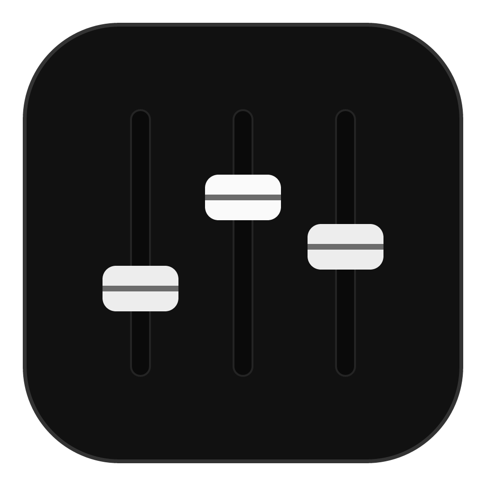
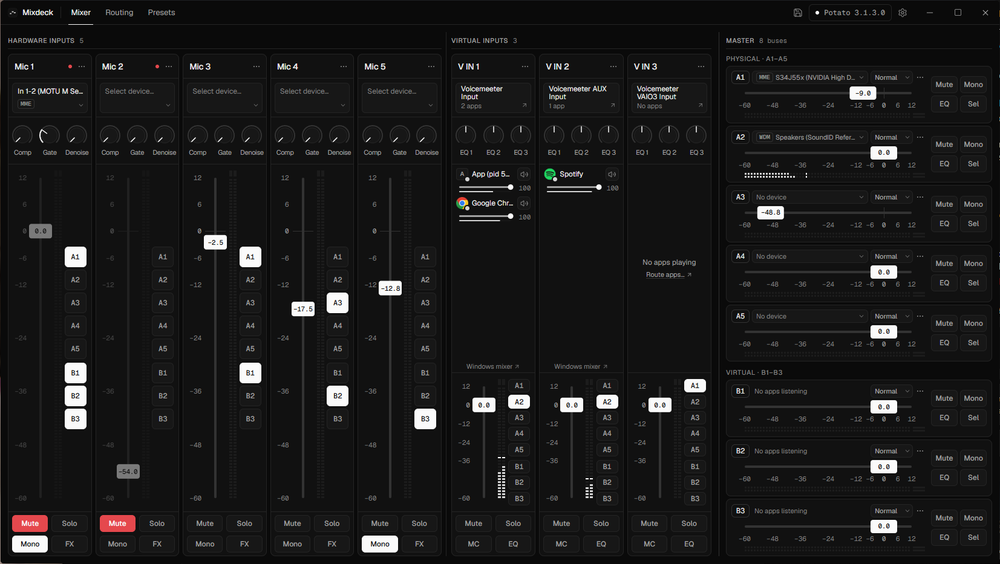

<p align="center">
  
</p>

<h1 align="center">Mixdeck</h1>

<p align="center">
  A clean, fast, resizable control surface for <b>Voicemeeter Potato</b> on Windows.
</p>

<p align="center">
  
</p>

Mixdeck is a modern replacement front end for Voicemeeter Potato. It gives you the same
inputs, buses, routing, effects and EQ in a window you can resize, collapse and drive from the
keyboard, without the fixed-size skeuomorphic panel.

It processes no audio itself. Mixdeck talks to your running Voicemeeter through the official
Remote API (`VoicemeeterRemote64.dll`), which it loads from your own Voicemeeter install. It
does not include, copy or redistribute any Voicemeeter file.

> Mixdeck is an independent project and is not affiliated with or endorsed by VB-Audio.
> Voicemeeter is a product of VB-Audio Software.

## Features

- **Mixer** for all 8 inputs and 8 buses (A1–A5, B1–B3): faders, meters, mute, solo, mono,
  bus modes and per-strip routing chips.
- **Routing matrix** to see and change every input → bus route at once, plus hardware device
  selection for inputs and outputs.
- **Strip effects:** compressor, gate and denoiser for hardware inputs; 3-band EQ for virtual
  inputs.
- **Bus EQ editor** with draggable nodes that update Voicemeeter live.
- **App volumes:** the virtual inputs list the apps playing into them, with volume and mute kept
  in sync with the Windows volume mixer.
- **Presets:** save your whole setup and load it back from the app or the tray.
- **Hotkeys:** in-app keyboard control, plus global hotkeys that work while Mixdeck is hidden.
- **Tray and autostart:** start minimized, launch at login, live in the system tray.
- **Auto-reconnect:** start or restart Voicemeeter at any time and Mixdeck picks it back up.

## Requirements

- Windows 10 or 11, x64
- [Voicemeeter Potato](https://vb-audio.com/Voicemeeter/potato.htm), installed with its
  official installer. Built and tested against 3.1.3.0; older builds work but log a warning.
  Banana and the basic edition aren't supported (Mixdeck shows a "wrong edition" screen).
- Microsoft Edge WebView2 Runtime. It ships with Windows 11 and current Windows 10, and the
  Mixdeck installer installs it if it's missing.

## Install

1. Download `Mixdeck_<version>_x64-setup.exe` from the [Releases](../../releases) page.
2. Run it. It installs for the current user only (no admin prompt) into
   `%LOCALAPPDATA%\Mixdeck` and adds a Start menu entry.

**Portable:** `mixdeck.exe` from a release runs without installing. It still keeps its
settings, presets and logs in your user profile (see [Where things live](#where-things-live)).

> **Windows SmartScreen warning:** release builds aren't code-signed, so Windows may show
> "Windows protected your PC" the first time. Click **More info → Run anyway**.

## Using Mixdeck

- **Faders:** drag (hold `Shift` for fine control), scroll, or use the arrow keys.
  Double-click resets to 0 dB; `Alt`-click or `Enter` lets you type a value. A fader turns red
  when it's above 0 dB (boost).
- **Apps:** the virtual inputs show the apps playing into them. Turn this off in
  Settings → Apps.
- **Collapse a strip** you don't use: ⋯ → Collapse. It becomes a thin rail with its name,
  mute dot and meter; click it to expand again. This is remembered.
- **Keyboard shortcuts** (only while the Mixdeck window is focused and you're not typing; also
  listed in Settings → Hotkeys):

  | Key | Does |
  | --- | --- |
  | `1`–`8` | Focus input strip 1–8 |
  | `Shift`+`1`–`8` | Focus bus A1–B3 |
  | `M` | Mute the focused strip or bus |
  | `S` | Solo the focused strip |
  | `↑` / `↓` | Gain ±0.5 dB (`Shift` for ±0.1 dB) |
  | `0` | Gain to 0.0 dB |
  | `F` | Open effects (strip) or the EQ editor (bus) |

  Global hotkeys, which work while Mixdeck is hidden, are set up in Settings → Hotkeys.

## Where things live

| What | Where |
| --- | --- |
| Settings, window position | `%APPDATA%\s4lo.lol.mixdeck\` |
| Presets | `%APPDATA%\Mixdeck\presets\` (Settings → About → Open presets folder) |
| Logs (1 MB × 5, rotated) | `%LOCALAPPDATA%\s4lo.lol.mixdeck\logs\` (Settings → About → Open log folder) |
| Launch at login | `HKCU\Software\Microsoft\Windows\CurrentVersion\Run`, value `Mixdeck` |

## Uninstall

Windows Settings → Apps → Mixdeck → Uninstall. This removes the program, its shortcuts and
the "Launch at login" entry. Tick **Delete the application data** to also remove your
settings, logs and presets, or leave it unticked to keep them for a later reinstall.

## Troubleshooting

- **"Voicemeeter isn't running":** start Voicemeeter Potato, or click *Launch Voicemeeter*.
  Mixdeck reconnects on its own when Voicemeeter starts or restarts.
- **"Voicemeeter not found":** Mixdeck looks for the DLL through Voicemeeter's uninstall
  registry key, then in `C:\Program Files (x86)\VB\Voicemeeter`. A copied Voicemeeter folder
  isn't enough; reinstall Potato with the official installer.
- **Connected but nothing moves:** a different Voicemeeter edition (Banana or basic) is
  running. Mixdeck needs Potato.
- **A global hotkey does nothing:** another app already uses that shortcut. Pick a different
  one in Settings → Hotkeys.
- **Anything else:** [open an issue](../../issues) and attach the latest `.log` file from the
  log folder (Settings → About → Open log folder). Crashes are logged there too.

## Building from source

Mixdeck is a [Tauri 2](https://tauri.app) app with a Rust backend and a React + TypeScript +
Tailwind frontend.

**You'll need:**

- [Node.js](https://nodejs.org) LTS and npm
- [Rust](https://rustup.rs) stable, MSVC toolchain (`stable-x86_64-pc-windows-msvc`)
- Visual Studio 2022 Build Tools with the **Desktop development with C++** workload
- Voicemeeter Potato, if you want to test against the real engine (optional, see below)

```powershell
npm install
npm run tauri dev                                   # run with hot reload
$env:MIXDECK_FAKE = "1"; npm run tauri dev          # run without Voicemeeter (fake engine)
cargo test --manifest-path src-tauri/Cargo.toml     # tests; also regenerates src/lib/generated/
npm run tauri build                                 # release build + installer
```

`MIXDECK_FAKE` simulates different situations so you can work on the UI without Voicemeeter:
`1` (Potato running), `offline` (not running), `banana` (wrong edition), `missing` (not
installed).

Release builds land in:

- Installer: `src-tauri/target/release/bundle/nsis/Mixdeck_<version>_x64-setup.exe`
- Portable exe: `src-tauri/target/release/mixdeck.exe`

### Project layout

```
src/                 React frontend (views in src/features/, registered in src/app/routes.ts)
src-tauri/src/
  vmr/               thin wrapper around the Voicemeeter Remote API DLL
  engine/            single worker thread that owns all DLL calls
  sessions/          Windows per-app audio sessions
```

## Credits

- Built on the [Voicemeeter Remote API](https://vb-audio.com/Voicemeeter/) by VB-Audio
  Software. No Voicemeeter files are included; Mixdeck loads the DLL from your own Voicemeeter install.
- Made in collaboration with [Claude Code](https://claude.com/claude-code).
